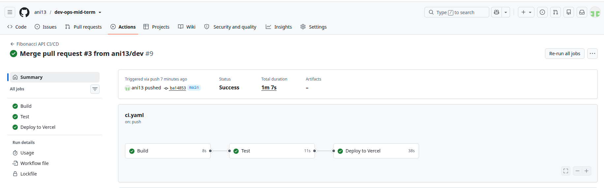
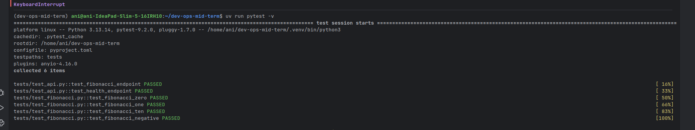
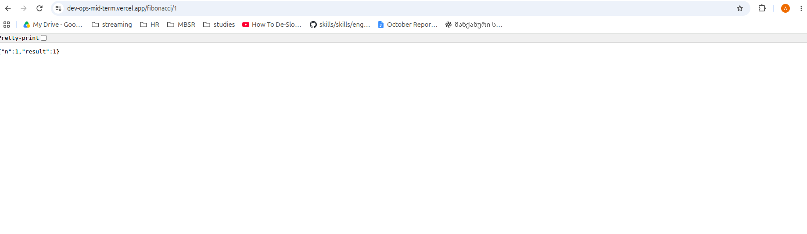
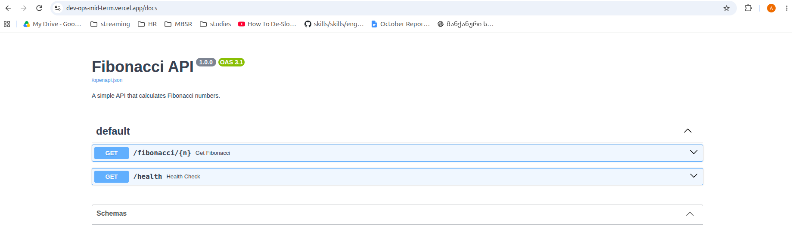
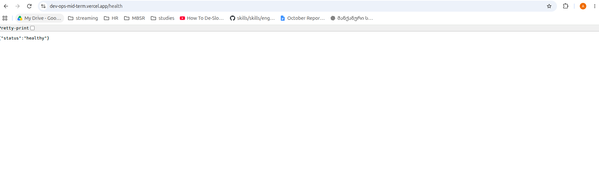

# Fibonacci API
 
## Project description

Fibonacci API is a simple REST API build with python and FastAPI. It calculates 
Fibonacci numbers based on user input and provides a health check endpoint to monitor application
availability.

The project uses GitHub Actions and vercel for CI/CD.

## Technologies Used
1. Python 3.13
2. FastAPI
3. uv - for package and dependency management
4. Pytest
5. HTTPX
6. GitHub Actions - CI/CD automation
7. Vercel - production deployment platform

## Running the project locally

> 1. Clone the repo 
>    2. git clone https://github.com/ani13/dev-ops-mid-term.git
>    3. cd dev-ops-mid-term
> 4. Install Dependencies
>    5. uv sync
> 6. Start the application
>    7. uv run uvicorn main:app --reload
> 8. Run automated tests
>    9. uv run pytest-v

## CI/CD Pipeline

The project used GitHub Actions to automate the Build, Test and Deploy stages.

Pipeline Stages

1. Build

    Checks out the repository.
    
    Sets up Python 3.13.
    
    Installs dependencies using uv.
    
    Checks Python syntax using py_compile.

2. Test
    
    Installs project dependencies.
    
    Runs automated tests using Pytest.
    
    Verifies the Fibonacci calculation and API endpoints.

3. Deploy

    Runs only when changes are pushed to the main branch.
    
    Retrieves Vercel production environment information.
    
    Builds the application using Vercel CLI.
    
    Deploys the application to Vercel Production.

## Branch Strategy

The project uses two main branches:

> main:  Production-ready code.

> dev:  Development and integration branch.

Pull requests and pushes to both branches trigger the Build and Test stages.

Deployment runs only after a successful Build and Test when code is pushed to main.

## Automatic Versioning

After a successful production deployment, GitHub Actions automatically increments the patch version in pyproject.toml.

For example:

> 1.0.0 → 1.0.1

The updated pyproject.toml and uv.lock files are committed automatically to main.

The version update commit uses [skip ci] to prevent another pipeline run.

## Monitoring and Health Check

The project includes a monitoring script (monitor.py) that periodically checks the availability of the deployed application.

The script:

- Sends an HTTP request to the production /health endpoint.
- Checks the HTTP response status.
- Logs successful health checks and errors.
- Writes monitoring information to monitor.log.
- Repeats the check every 30 seconds.

Run the monitoring script:

> uv run python monitor.py

Production Health Check URL:

> https://dev-ops-mid-term.vercel.app/health

## Production Deployment

The application is deployed on Vercel.

> Production URL: https://dev-ops-mid-term.vercel.app

> API Documentation: https://dev-ops-mid-term.vercel.app/docs

> Health Check: https://dev-ops-mid-term.vercel.app/health

Screenshots

1. Successful CI/CD Pipeline

2. Successful Automated Tests

3. Running Production Application

4. API Documentation

5. Monitoring and Health Check

